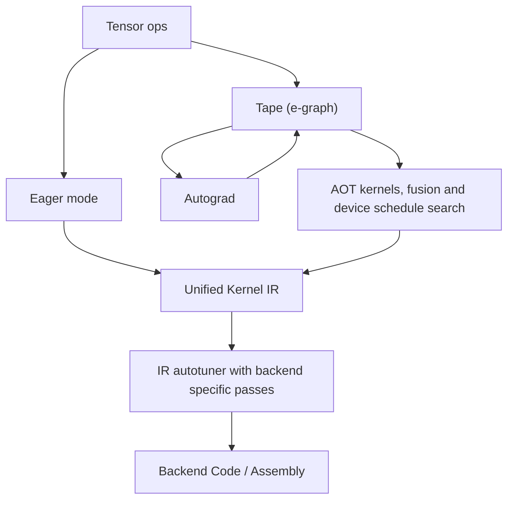

# zyx

**ML library for your hardware**

[](https://crates.io/crates/zyx)
[](https://pypi.org/project/zyx-py/)
[](https://docs.rs/zyx)
[](https://github.com/zk4x/zyx/actions/workflows/build-wheels.yml)
[](https://github.com/zk4x/zyx/blob/main/LICENSE.md)
[](https://github.com/zk4x/zyx)


# Why?

ML was enabled by new kinds of highly parallel, high performance hardware that did not exist before.

Zyx has 3 goals:
1. Be correct
2. Run everywhere (all hardware)
3. Run fast

And be nice to use.

ML won't get better without new hardware; existing libraries may not be the best fit for emerging hardware.
The primary problem is the requirement to write custom kernels to get the required performance.
Manufacturers have a tough time writing these high performance kernels; therefore they write kernels for only
a few ops and don't support general linear algebra.

Zyx approaches these problems from two angles:

### 1. Supporting all ops

Zyx has linear SSA-ish IR with explicit control flow. This is the hardware unifying interface. Each piece of hardware has
add instructions, can repeat instructions (loop), is highly parallel (work sizes), has multiple types of memory
in a hierarchy (or at least global and registers) and can optionally have vectorization and tiling.
This is the core of the instruction set. Zyx has a series of optimization passes (selected by autotuner)
that apply various optimizations for different levels of these characteristics. The lowering layer from IR
to backends is an almost 1:1 mapping. If your hardware can provide this translation, the whole stack
(zyx ops, `zyx-nn`, `zyx-optim`) works on it.

### 2. Bringing top performance

As good as the automatic optimizations can be, writing manual kernels will usually be faster, which is why
it is the dominant approach as of now. Zyx acknowledges this and its e-graph system pattern matching
of any subgraph structure into a custom kernel written in a language of your choosing
(or raw binary blobs, cublas, cblas, etc.), as well as writing custom kernels in zyx IR and taking advantage
of optimization passes zyx provides. The e-graph measures their timings, compares them with auto-generated zyx kernels
and picks the fastest path through this graph.

The other issue is running on edge platforms that don't have sufficient resources. Zyx takes only about 5 MB and uses
machine-available drivers to run, such as a provided C compiler or CUDA runtime; for example, if you don't install
CUDA, any GPU driver with Vulkan support is sufficient.


## Features

- **Eager mode, Lazy JIT Execution** — tensor operations fuse into kernels as you write them; when fusion is no longer possible, the kernel executes. For one-off computations.
- **Tape (e-graph)** — wrap loop bodies in a `Tape` for lazy graph building, autograd and e-graph-based fusion optimization. Computation happens when realize is called. For repeated computations.
- **Cross‑Platform Backends** — codegen for C, CUDA (CUDA C or PTX), OpenCL, SPIR-V (Vulkan/WGPU), and the Tensix RISC-V path for Tenstorrent.
- **Linear‑Algebra Coverage** — mirrors the PyTorch ops API (matmul, convolutions, pooling, reductions, indexing, etc.) by stacking ops. Stack more ops yourself to get more op coverage; zyx auto fuses and optimizes it.
- **Explicit In-Place Writes** — tensors are values, so nothing mutates behind your back; the one in-place write is `Tensor::assign`, and it is recorded as an op in the graph.
- **Explicit Tape** — you control what is recorded via `Tape`; no need for `torch.no_grad()` or requires_grad semantics.
- **Everything is diff** — every tensor in a tape can be differentiated w.r.t. any other tensor in a tape.
- **Lazy Device Loading** — tensors load from their current memory pool (disk, another device) into the compute device only when needed.
- **Parallel Pipelining** — the graph's fusion and device paths compete and extraction keeps the fastest measured one; plans pipeline kernels and cross-device copies across heterogeneous devices automatically.
- **Lean Dependencies** — the core needs `libloading` (driver loading) and `nanoserde` (config), plus `libc`/`libm` for the simulator; the Tenstorrent path adds its firmware and ISA crates. WGPU is the only large optional dependency.


## Crates

| Crate | Description |
|-------|-------------|
| `zyx` | Core tensor library with all backends and autodiff |
| `zyx-nn` | Neural network layers (Linear, Conv2d, Attention, etc.) and `#[derive(Module)]` |
| `zyx-optim` | Optimizers (SGD, Adam, AdamW, RMSprop) |


## Installation

```bash
# from crates.io
cargo add zyx zyx-nn zyx-optim

# from PyPI, contains all backends, nn and optim
pip install zyx-py
```

> The PyPI package is `zyx-py`, not `zyx` — `pip install zyx` installs an
> unrelated project. The import name is still `zyx`.

See [INSTALL.md](INSTALL.md) for backend prerequisites (compilers, GPU runtimes,
the Tenstorrent simulator) and for building zyx from source.


## Configuration & Debugging

- [Configuration](CONFIG.md) - Hardware device selection, autotune settings
- [Environment Variables](ENV_VARS.md) - Debug flags


## 🐍 Python Bindings

```python
import zyx

x = zyx.Tensor.randn(2, 3)
y = zyx.Tensor.uniform_(2, 3, from_=-1.0, to_=1.0)
z = x.relu() + y.tanh()
print(z.shape)          # [2, 3] — a list, and nothing has executed yet

# Autograd with a tape
tape = zyx.Tape()
tape.add(x)
tape.add(y)
result = (x.gelu() * y).sum()
gx, gy = tape.gradient(result, [x, y])
tape.realize([result, gx, gy])
print(gx.numpy())
```

See [zyx-py/README.md](zyx-py/README.md) for the full Python guide.


## Neural Nets

A training loop with a two-layer network, using `Tape` for autograd and optimizations:

```rust,no_run
use zyx::{Tensor, DType, Tape, Module};
use zyx_nn::Linear;
use zyx_optim::SGD;

#[derive(zyx_nn::Module)]
struct SimpleNet {
    linear1: Linear,
    linear2: Linear,
}

impl SimpleNet {
    fn new(dtype: DType) -> Result<Self, zyx::ZyxError> {
        Ok(Self {
            linear1: Linear::new(784, 128, true, dtype)?,
            linear2: Linear::new(128, 10, true, dtype)?,
        })
    }
    
    fn forward(&self, x: &Tensor) -> Tensor {
        let x = self.linear1.forward(x).unwrap().relu();
        self.linear2.forward(&x).unwrap()
    }
}

fn main() -> Result<(), zyx::ZyxError> {
    let mut model = SimpleNet::new(DType::F32)?;
    let mut optim = SGD::default();
    let x = Tensor::randn([64, 784], DType::F32)?;
    let target = Tensor::randn([64, 10], DType::F32)?;
    
    for _ in 0..100 {
        let tape = Tape::new(&model)?;
        let output = model.forward(&x);
        let loss = output.mse_loss(&target)?;
        let grads = tape.gradient(&loss, &model);
        optim.update(&mut model, grads);
        tape.realize(model.iter().chain([&loss]))?;
    }
    
    Ok(())
}
```

For more complex examples:
- [Examples](examples/) - MNIST, RNN, llama, nanogpt and others


## Custom Kernels

Hand-optimize kernels for peak performance using hardware-specific features (e.g. tensor cores) with the zyx kernel IR:

```rust
use zyx::kernel::{Dev, Kernel};
use zyx::{DType, Tensor};

let mut kernel = Kernel::new(Dev::Auto);
let n = 4;
let inp = kernel.param(DType::F32);
let len = kernel.const_idx(n);
let gidx = kernel.group_range(0, len);
let loaded = kernel.load(inp, gidx);
let result = kernel.mad(loaded, loaded, loaded); // x*x + x
let out = kernel.param_mut(DType::F32);
kernel.store(out, result, gidx);

let compiled = kernel.compile()?;
let x = Tensor::from([1.0f32, 2.0, 3.0, 4.0]).to(compiled.device())?;
let result = compiled.forward(&[&x], vec![[n]])?;
let data: Vec<f32> = result.into_iter().next().unwrap().try_into()?;
assert_eq!(data, vec![2.0, 6.0, 12.0, 20.0]);
# Ok::<(), zyx::ZyxError>(())
```

See the [kernel module docs](https://docs.rs/zyx/latest/zyx/kernel/) for a WMMA (tensor-core) matmul example.


## Architecture



Outside the tape, tensor operations fuse eagerly into kernels as you call them using a unified kernel IR.
Inside a tape, a lazy graph is built and analyzed for fusion opportunities during realization
or may have parts pattern-matched into AOT kernels. Different device allocations are also compared.
The fused operations are lowered to a unified kernel IR. Kernel IR is then autotuned and compiled
to native code for the target backend.


## How zyx compares

Zyx is a library, not a workflow: it doesn't prescribe training loops or data pipelines. The table below compares its design choices feature by feature.

| Feature | PyTorch | JAX | TVM | tinygrad | candle | burn | luminal | zyx |
|---|---|---|---|---|---|---|---|---|
| **Language/front-end** | Python + C++ | Python | Python + C++ | Python | Rust | Rust | Rust | Rust + Python |
| **Execution model** | eager | lazy (traced) | AOT-compiled | lazy | eager | eager API, lazy JIT execution | static graphs | lazy JIT outside a `Tape`, deferred inside |
| **Graphs** | eager ops + separate autograd graph | one jaxpr for both | graph → IR | single UOp graph for everything | none (eager) | dynamic graph, JIT-fused streams | static DAG | one graph for laziness and autograd |
| **Autograd** | `requires_grad`/`no_grad` | `grad` transform | n/a | graph-based | built-in | autodiff as a backend decorator | graph-based | `Tape` scoped |
| **Compiled replay** | — | `jit` | AOT | `TinyJit` | — | — | AOT | `Tape::freeze`/`replay` |
| **Fusion** | `torch.compile` | XLA | operator fusion | heuristics | manual | automatic kernel fusion | e-graph fusion variants | e-graph fusion variants |
| **Autotuning** | Triton autotune | XLA | explores optimization sequences | over kernel variants | n/a | autotuned kernel selection | via e-graph (egglog) | out-of-order passes, each measured |
| **Custom kernels** | C++/CUDA ops, Triton | pallas, custom calls | codegen templates | written in UOp IR | embed foreign kernels (flash-attn) | custom kernels | e-graph pattern-matching AOT kernels | written in zyx IR, or e-graph AOT patterns |
| **Tensor mutability** | mutable | immutable | n/a (compile-time) | immutable | mutable | mutable | n/a (compile-time) | values; one explicit `assign` |
| **Device/memory movement** | manual `.to()` | explicit placement | pipelines across devices/memories | per-op device semantics | manual | manual | compiler-searched ahead of time | pipelines across devices/memories |
| **Hardware backends** | CPU, CUDA, MPS, ROCm, XPU | CPU, GPU, TPU | CPU, GPU, NPU | CPU, CUDA, OpenCL, Metal, HIP, NV, QCOM | CPU, CUDA, Metal, WASM | CPU, CUDA, ROCm, Metal, Vulkan, WebGPU, LibTorch | CPU, CUDA, Metal | C, CUDA, OpenCL, Vulkan, WGPU, Tensix — one small codegen file per backend |
| **Data parallelism** | DDP/FSDP | data-parallel sharding | — | multi-GPU sharding | multi-GPU via NCCL (tensor parallel) | DDP | — | manual (automatic in the roadmap) |


## Backends

- [x] **C** - C codegen (clang/gcc)
- [x] **CBLAS** - AOT matmul via OpenBLAS
- [x] **CUDA**
- [x] **OpenCL**
- [x] **Vulkan** - SPIR-V codegen
- [x] **WGPU** - SPIR-V codegen, feature: `wgpu`
- [ ] **Tenstorrent** - preliminary, always built, runs through the bundled simulator (`TT_TTSIM_LIB`)

If you'd like to add a new backend to zyx, that would be awesome!
Please read [ADDING_BACKENDS.md](https://github.com/zk4x/zyx/blob/main/ADDING_BACKENDS.md)


## Benchmarks

Benchmarks are here in [BENCHMARKS.md](https://github.com/zk4x/zyx/blob/main/BENCHMARKS.md)
More will be added later. Feel free to try writing models in zyx and creating a PR with your
your measured results.

## Roadmap

- [ ] full tenstorrent coverage
- [ ] automatic device sharding search
- [ ] more backends
- [ ] more optimization passes
- [ ] more AOT kernels
- [ ] more benchmarks
- [ ] more model examples


## Status & License

- **Status**: Stable API with active performance optimization
- **License**: LGPL-3.0-only (all crates)
- **Rust Version**: stable rust >= 1.88.0
- **Platforms**: Linux (primary), macOS. Windows is unsupported — open a GitHub issue if you need it.


## For Devs

- [Architecture Book](https://zk4x.github.io/zyx/) - How zyx works under the hood
- [Contributing](CONTRIBUTING.md) - How to contribute
- [Adding backends](ADDING_BACKENDS.md) - How to add new backends, information for hardware vendors
- [Style](STYLE.md) - Zyx code style
- [API Reference](https://docs.rs/zyx) - Complete API documentation
- [Issues](https://github.com/zk4x/zyx/issues) - Bug reports and feature requests

---

<div align="center">
<a href="https://github.com/zk4x/zyx">
    
    Star on GitHub
</a> | 
<a href="https://docs.rs/zyx">
    
    API Docs
</a>
</div>
